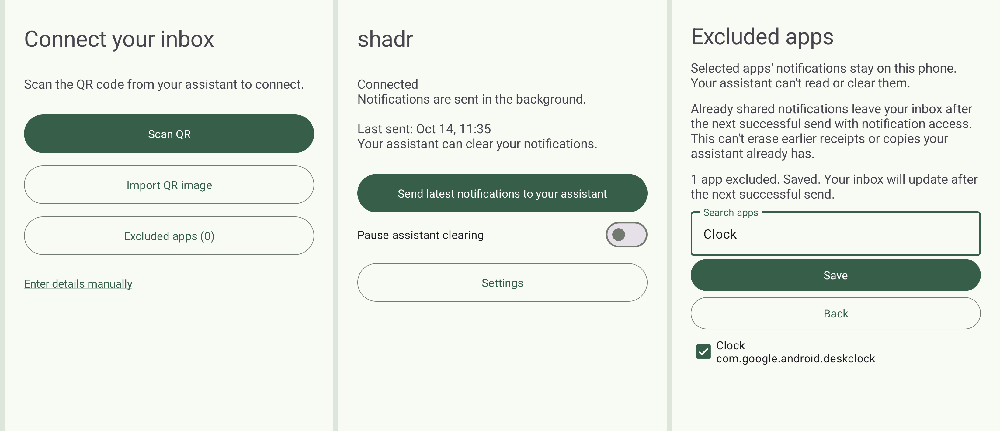

# shadr

Let your assistant read and clear your Android notifications without opening each app. Ask for a summary of what's on your phone, or ask it to clear notifications you no longer need.

The app sends your current notifications to a private inbox for your assistant. Pair once with a QR code and grant notification access. No mandatory app-selection checklist or waiting period. Use **Excluded apps** to keep selected apps private, or **Pause assistant clearing** to stop clearing while updates continue to send.

Use it with Pi, Grokbot or any other agent that can make authenticated web requests and keep credentials private. There is no required AI provider or model. Your agent can use it on demand. Only scheduled routines need an agent or scheduler running at the chosen time.

## What you need

- An Android phone running Android 8 or newer, with Google Play services.
- A Google account for a free Firebase project. Your assistant creates and configures it for command delivery. You may need to sign in or complete account verification. FCM itself needs no paid plan.
- An assistant that can follow this repository's setup instructions, make web requests and store credentials privately.
- Somewhere to run the inbox: Cloudflare, or an always-on computer or server.
- Internet access on the phone. The normal setup does **not** require Tailscale on your phone.

Your assistant can prepare the inbox. You approve account access, any hosting charges, app installation and Android permissions.

## Get started with your assistant

Give your assistant the link to this repository and say:

> Set up shadr for me. Follow AGENTS.md. Help me choose hosting, give me the signed release APK, then pair my phone and test reading and clearing a harmless notification.

1. **Choose hosting.** Cloudflare works independently of your computer. Self-hosting uses your always-on machine and a public HTTPS connection through Tailscale Funnel. Your assistant should explain any costs and privacy trade-offs first, then help configure Firebase push delivery for either option.
2. **Install the app.** Open this repository's **Releases** page and download the signed `shadr.apk`, or use the verified download link your assistant gives you. Open it on your phone and approve installation from that source. Do not use a debug APK for ordinary use.
3. **Pair.** Open shadr and choose **Scan QR** or **Import QR image**. Your assistant supplies the QR privately. The app checks and saves the connection automatically.
4. **Choose any exclusions, then allow access.** Before granting notification access, use **Excluded apps** if there are apps you don't want to share. Follow the app's permission instructions, then return and choose **Send latest notifications to your assistant**. shadr uses a quiet status notification while processing assistant commands.
5. **Try it.** Ask your assistant to read a harmless notification and clear it. It should confirm the phone actually cleared it, not just that a request was queued.

On Android 13 or newer, sideloading may cause **App was denied access**. Open **Settings > Apps > shadr > ⋮ > Allow restricted settings**, then enable notification access. The app's **Open app settings** button takes you to the right app page.

Keep the same signing identity when updating. A release APK cannot update an old debug installation. Do not uninstall to work around that without first agreeing to lose its settings and pair again.

## Everyday use

Ask for the current notifications whenever you want. Your assistant can also set up a daily summary at a time you choose. Nothing schedules itself.

**Settings > Excluded apps** keeps selected apps' notifications on your phone. Their content, app names and notification identifiers are filtered out before upload, and the assistant cannot clear them. The exclusion list stays on your phone. No apps are excluded by default.

**Pause assistant clearing** stops new clearing actions without stopping uploads. Turn it off to resume. Android may refuse to clear an ongoing notification.

Phone changes trigger an upload. An assistant command sends a Firebase Cloud Messaging wake signal so the phone can fetch it, clear the selected notifications and return the result. The app does not poll or upload periodic full snapshots while idle. Delivery still depends on connectivity, Google Play services and Android's background restrictions. A queued command or accepted push is not proof that anything was cleared.

## Privacy and limits

Notification access includes private message previews. Your hosting service and authorised assistant can read uploaded content. Recognised authentication-code content is removed on the phone before upload, but pattern matching cannot catch every possible secret.

Choose exclusions before granting notification access to prevent the first upload. If you exclude an app later, its notifications leave the latest inbox snapshot after the next successful upload with notification access connected. Earlier uploads, action receipts and copies already read by your assistant cannot be retracted by this setting.

Google handles the push registration and wake signal. Notification titles, message bodies, clearing keys and relay credentials are not included in that signal. They travel directly between the phone and your inbox.

The inbox holds the latest snapshot, pending clearing requests and seven days of action receipts. It is not a notification archive. Notifications that arrive and disappear while disconnected may never reach it.

Keep the pairing QR, credentials and database private. Public self-hosting uses HTTPS and secret tokens, but has no extra Cloudflare Access layer or application rate limiter. Your assistant should explain that before publishing the endpoint.

### Where credentials live

- **Phone:** the phone token and any Cloudflare Access credentials are stored in Android app-private preferences. Android backup is disabled. There is no additional app-level encryption or Keystore vault; protection relies on Android's sandbox and the device's security.
- **Relay:** self-hosted credentials are in private configuration files, including `.dev.vars`. Cloudflare deployments use Worker secrets. The Firebase sender's private key stays on the relay, never in the APK or assistant's configuration.
- **Assistant:** a separate private `bot.env` file contains only its token, endpoint and any required Access credentials. Setup restricts files to the owning account using Unix permissions or Windows ACLs. These files are not encrypted by shadr.

The pairing QR contains phone credentials. Treat it as a password and delete it after pairing. Your Google-account password is not stored by shadr. Uploaded notification content is readable by the relay and authorised assistant; it is not end-to-end encrypted.

For help, start with the app's status and your assistant's connection check. If the hosting computer is off, restore it before changing phone permissions.

## More

- [Screenshots](screenshots/README.md)
- [Hosting, pairing and recovery](docs/setup.md)
- [Assistant integration](docs/consumer.md)
- [Agent skill](SKILL.md) for reading notifications, requesting clears and checking status
- [Building, signing and testing Android](docs/android.md)
- [API reference](docs/api.md)
